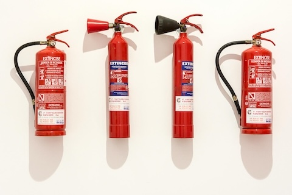
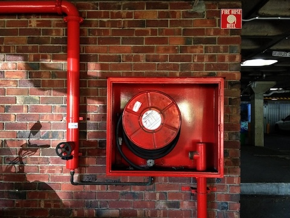
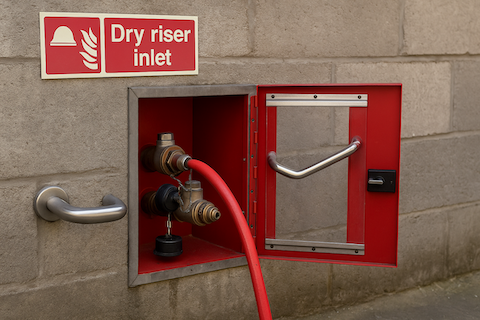
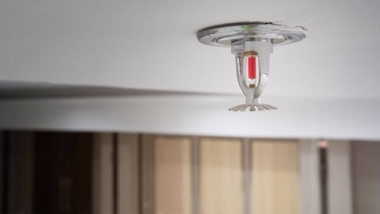

# Protocolos de Segurança

Antes de trabalhar com hardware de computador, é essencial compreender e aplicar regras de segurança que protejam não apenas o equipamento, mas também as pessoas que o manuseiam e o ambiente. Mesmo pequenos erros durante a desmontagem ou montagem podem resultar em lesões, danos aos componentes ou riscos como incêndio e choque elétrico. Ao seguir as regras de segurança, você garante um ambiente de aprendizagem seguro e desenvolve bons hábitos profissionais que servirão por toda a sua carreira.

Nesta seção, revisaremos **oito áreas-chave de segurança** para orientar seu trabalho:

1. Segurança no local de trabalho  
2. Prevenção de acidentes  
3. Fatores gerais de risco  
4. Fatores gerais de risco no manuseio de computadores  
5. Sinalização de segurança  
6. Precauções na oficina  
7. Métodos e sistemas de extinção de incêndio  
8. Primeiros socorros

## Eletricidade no computador: Riscos Ocupacionais e Proteção Ambiental

### 1) Segurança no local de trabalho

É o conjunto de **técnicas e procedimentos destinados a eliminar ou reduzir o risco** de acidentes de trabalho e os danos que possam causar: principalmente às pessoas, mas também ao patrimônio e ao meio ambiente.

Seu objetivo é **prevenir acidentes de trabalho** evitando sua ocorrência ou minimizando suas consequências imediatas sobre pessoas e bens. Portanto, a segurança no trabalho considera não apenas acidentes que causam lesões, mas também aqueles que poderiam potencialmente causá-las.

### 2) Prevenção de acidentes

A segurança visa prevenir acidentes de trabalho, que são essencialmente eventos anormais, não intencionais e indesejados que ocorrem inesperadamente e geralmente são evitáveis. Eles interrompem a atividade normal de trabalho e podem causar lesões às pessoas. Existem situações que podem levar a acidentes, com ou sem lesões (incidentes).

Para prevenir acidentes, é necessário:
  * Conhecer os riscos a que estamos expostos
  * Entender que um acidente pode acontecer a qualquer momento
  * Estar ciente de que pode acontecer com você também
  * Compreender as reais consequências dos acidentes
  * Estar informado sobre as perdas humanas e financeiras que os acidentes podem causar


### 3) Fatores gerais de risco

*Ambiente*: Deve garantir conforto térmico, visual e acústico. A falta desses fatores pode levar a erros que podem causar acidentes ou simplesmente resultar em irritabilidade. Uma situação confortável é aquela em que as variáveis ambientais não criam distrações, fadiga ou desconforto. O objetivo é garantir que a pessoa não sinta desconforto que distraia sua atenção ou a impeça de se concentrar em elementos importantes para sua saúde e segurança.

*Organização*: Um elemento-chave do ambiente é como o trabalho é organizado (treinamento, informação, comunicação, relações de grupo, etc.), que também deve ser confortável e bem adaptado aos trabalhadores.

*Conforto psíquico*: Isso é menos óbvio do que o conforto físico ou mental e depende das características individuais de cada pessoa. A psicologia nos ajuda a agrupar comportamentos para prever reações. O desconforto pode aparecer a curto prazo (irritabilidade, ansiedade), médio prazo (distúrbios do sono, dores de cabeça tensional) ou longo prazo (depressão, problemas gastrointestinais, cardiovasculares ou de pele), afetando as pessoas dentro e fora do local de trabalho.

### 4) Fatores gerais de risco no manuseio de computadores

<u>Instalações elétricas</u>: Os sistemas de computador são alimentados por eletricidade, que pode causar choques elétricos ao trabalhador.

<u>Materiais com risco de incêndio</u>: Curto-circuitos elétricos podem causar incêndios não apenas no computador, mas também no sistema elétrico do prédio.

<u>Manuseio de ferramentas ou componentes</u>: O uso de ferramentas ou peças de computador apresenta riscos para o trabalhador.

<u>Ambiente de trabalho</u>: Ruído, umidade, poeira, frio, etc., podem afetar a saúde do trabalhador.

<u>Posturas forçadas</u>: A postura adotada durante o trabalho diário pode causar problemas físicos ao trabalhador.

<u>Manuseio de cargas</u>: Carregar materiais pesados pode causar lesões físicas.

<u>Carga mental e dependência</u>: Concentrar-se por longos períodos também pode ser um fator de risco. O uso excessivo do computador pode levar a dependências (de Internet, jogos, mensagens, redes sociais, etc.) que devem ser tratadas antes que se tornem problemas de saúde.  

### 5) Sinalização de segurança

É importante conhecer e respeitar os sinais de advertência que aparecem em diferentes elementos.


```{image} images/safety1-1.png
:width: 90%
:align: center
:alt: Imagem contém vários sinais de advertência de segurança.
```

```{image} images/safety1-2.png
:width: 90%
:align: center
:alt: Imagem contém vários sinais de advertência de segurança.
```

```{image} images/safety1-3.png
:width: 90%
:align: center
:alt: Imagem contém vários sinais de advertência de segurança.
```


```{image} images/safety2.png
:width: 80%
:align: center
:alt: Imagem contém vários sinais de advertência de segurança.
```

Além das precauções, também verificaremos se cumprem as principais normas de segurança, especialmente as da Comunidade Europeia.

1. **Regulamentado pelos Estados Unidos e Canadá** (Pode ser encontrado em discos rígidos, disquetes...)
```{image} images/RegulatedbyUSandCanada.png
:width: 25%
:align: center
:alt: Imagem do indicador de regulamentação pelos Estados Unidos e Canadá.
```
2. **Regulamentado pela União Europeia** (Aprovado pelas normas de segurança da União Europeia)
```{image} images/RegulatedbyEU.png
:width: 25%
:align: center
:alt: Imagem do indicador de regulamentação pela UE.
```
3. **Normas Europeias de Certificação Elétrica** (Aprovado pelas normas de segurança elétrica da União Europeia)
```{image} images/EUCertificationStandards.png
:width: 25%
:align: center
:alt: Imagem do indicador de conformidade com as normas da UE.
```
4. **Regulamentado por normas alemãs** (TEST) (Geprüfte Sicherheit)
```{image} images/GermanStandard.png
:width: 25%
:align: center
:alt: Imagem do indicador de conformidade com a norma alemã.
```

### 6) Precauções na oficina

```{image} images/Safety_Rules_Icons/Location.png
:width: 7%
:align: left
:alt: Ícone indicador das regras de segurança de Localização.
```
**Localização**: Escolha um local de trabalho seco e bem ventilado. Deve haver luz suficiente para ver claramente todos os componentes. Evite áreas com carpete ou tapetes, pois tendem a gerar eletricidade estática. Uma boa escolha seria uma superfície nua e aterrada.

```{image} images/Safety_Rules_Icons/Static_electricity.png
:width: 7%
:align: left
:alt: Ícone indicador de segurança contra eletricidade estática.
```
**Eletricidade estática**: A eletricidade estática é o maior perigo para as peças que montamos. Mesmo uma descarga minúscula, pequena demais para sentirmos, pode danificar peças eletrônicas caras e delicadas como CPU, RAM e outros chips. É importante usar uma pulseira antiestática.

```{image} images/Safety_Rules_Icons/Power_supply.png
:width: 7%
:align: left
:alt: Ícone indicador de segurança da fonte de alimentação.
```
**Fonte de alimentação**: Desligue o computador e desconecte a fonte de alimentação antes de instalar ou remover qualquer componente. Se houver eletricidade circulando pelos componentes durante o manuseio, eles podem ser danificados, inclusive a placa-mãe.
Nunca corte ou remova o fio terra do cabo de alimentação. Esta medida de segurança protege contra possíveis descargas de alta voltagem entre o computador e o usuário.

```{image} images/Safety_Rules_Icons/Cuts.png
:width: 7%
:align: left
:alt: Ícone indicador de segurança contra cortes.
```
**Cortes**: Cortes podem ocorrer ao usar ferramentas pontiagudas (chaves de fenda, descascadores de fios, facas, etc.) ou por partes metálicas afiadas dentro do computador. Tenha cuidado com bordas cortantes, especialmente dentro do computador. Manuseie o interior do gabinete e seus componentes com cuidado para evitar cortes nas mãos. (Bordas afiadas do gabinete podem ser suavizadas com lixa antes da montagem.)

```{image} images/Safety_Rules_Icons/Disassembling_components.png
:width: 7%
:align: left
:alt: Ícone indicador das regras de segurança ao desmontar componentes.
```
**Desmontagem de componentes**: Evite desmontar componentes eletrônicos como a fonte de alimentação ou monitor, pois é muito perigoso. Eles contêm capacitores de alta voltagem que podem causar choques elétricos graves se tocados. Você pode receber um choque grave ou até fatal, mesmo com o aparelho desligado, pois eles armazenam muita energia.


```{image} images/Safety_Rules_Icons/Toxicity.png
:width: 7%
:align: left
:alt: Ícone indicador das regras de segurança contra toxicidade.
```
**Toxicidade**: Alguns componentes eletrônicos podem ser tóxicos, portanto estamos expostos a esse risco, geralmente por meio de ferimentos.

```{image} images/Safety_Rules_Icons/Short_circuit_or_fire.png
:width: 7%
:align: left
:alt: Ícone indicador das regras de segurança contra curto-circuito ou incêndio.
```
**Curto-circuito ou incêndio**: Um incêndio pode ser causado por um curto-circuito elétrico, superaquecimento ou até mesmo explosão de bateria. Devemos evitar ter líquidos condutivos por perto ao manusear o computador (café, água, etc.) e impedir que objetos metálicos caiam dentro do gabinete enquanto o computador estiver ligado.
É importante verificar se as aberturas de ventilação não estão bloqueadas e estão funcionando corretamente.

### 7) Métodos e sistemas de extinção de incêndio

Métodos de extinção:

```{list-table}
:header-rows: 0

* - 
  - Extintores de incêndio
* - 
  - Mangueiras de incêndio
* - 
  - Colunas secas em edifícios
* - 
  - Sprinklers automáticos
```

Diferentes materiais e equipamentos exigem diferentes tipos de extintores de incêndio. Saber qual extintor usar pode evitar acidentes e proteger tanto pessoas quanto dispositivos. A imagem abaixo mostra as **cinco classes de incêndio (A, B, C, D e K)**. Cada classe refere-se ao tipo de material que está queimando, por exemplo, Classe A para papel e têxteis, Classe B para líquidos inflamáveis e Classe C para equipamentos elétricos.


#### Classes de incêndio

```{image} images/Extinguishing_systems/Fire_Classes.png
:width: 90%
:align: center
:alt: Mangueira de incêndio.
```

Diferentes extintores são projetados para diferentes classes de incêndio. Usar o extintor errado pode piorar o incêndio ou causar danos. A tabela abaixo mostra quais extintores são seguros e eficazes para cada tipo de incêndio.

| Tipo de Extintor | CLASSE A | CLASSE B | CLASSE C | CLASSE D | CLASSE K |
|---|---|---|---|---|---|
| Espuma | **Sim** | **Sim** | Não | Não | Não |
| Pó ABC | **Sim** | **Sim** | **Sim** | Sim | Não |
| Dióxido de Carbono | Não | **Sim** | Não | **Sim** | Não |
| Químico úmido | **Sim** | Não | Não | Não | **Sim** |
| Água | **Sim** | Não | Não | Não | Não |

```{infonote} 
Ao lidar com equipamentos elétricos, como computadores, sempre use um **extintor Classe C** (ex: CO₂ ou Halotron). Eles não conduzem eletricidade e evitam danos adicionais aos dispositivos.
```


### 8) Primeiros socorros

<u>Tratamento de feridas:</u>

Lave a ferida com bastante água e sabão neutro, depois desinfete com álcool. Inspecione a ferida e remova qualquer corpo estranho, se houver, depois desinfete novamente com álcool. Deixe a ferida exposta ao ar se não houver risco de contato; caso contrário, cubra com um curativo.

<u>Tratamento de queimaduras:</u>

Se necessário, remova toda a roupa da área queimada, exceto a que estiver grudada na pele. Mergulhe a área queimada em água fria por 10 minutos, repetindo a cada 40 minutos se a dor persistir. Se a dor não passar, procure um médico.

<u>Emergências oculares:</u>

Devem ser tratadas apenas por oftalmologistas. As lesões oculares mais graves são: queimaduras, que devem ser tratadas como queimaduras (limpeza e água fria); trauma ocular causado por pancadas, solda ou objetos cortantes, caso em que o olho deve ser coberto; e contusões ao redor da pálpebra, onde pode-se aplicar gelo indiretamente.

<u>Substâncias tóxicas:</u>

Se substâncias corrosivas forem ingeridas, beba leite ou água. Se a substância for ácida, tome magnésia; se for alcalina, tome vinagre ou limão. Em caso de hospitalização, deve-se levar uma amostra da substância e entrar em contato com o Instituto de Toxicologia.

Se substâncias não corrosivas forem ingeridas, deve-se induzir o vômito provocando a úvula com uma colher ou bebendo uma xícara de café com sal.

Na folha a seguir 👇, você encontrará um **resumo das Regras de Segurança para Montagem e Desmontagem de Computadores**, que deverá usar como referência em todas as próximas sessões:

```{image} images/Safety_Rules_Sheet.png
:width: 100%
:align: center
:alt: Resumo das Regras de Segurança para Montagem e Desmontagem de Computadores.
```
