# Instruções de desmontagem

```{suggestionnote}
Nesta sessão você irá:
- Colaborar em seus grupos para **desmontar um computador** com segurança.
- Desenvolver um **tutorial de desmontagem** detalhando cada etapa e documentando o processo sequencialmente com fotos e descrições.
```

Desmontar significa separar um dispositivo em partes distintas.

Materiais necessários:

- Um PC funcional
- Pulseira antiestática
- Tapete antiestático
- Sacos antiestáticos (vários tamanhos)
- Kit de ferramentas do técnico
- Copo ou caixa de plástico para organizar parafusos, porcas e arruelas

Procedimento:

| Etapa | Instruções |
|---|---|
| 1. Desconectar | ✓ Desconecte o cabo de alimentação do PC. <br>✓ Desconecte todos os periféricos conectados ao computador, como teclado, mouse, monitor, fones de ouvido. |
| 2. Abrir o gabinete | 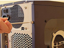 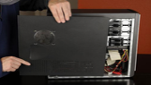 <br> Primeiro remova os parafusos da tampa lateral esquerda e deslize a tampa lateral. |
| 3. Desconectar todos os conectores | 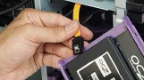 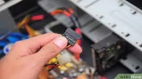 <br> Desconecte todos os conectores ligados à placa-mãe. Isso inclui o cabo de alimentação SATA e o cabo de dados. |
| 4. Remover o ventilador | 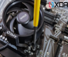 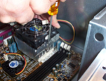 <br> Remova agora o ventilador. |
| 5. Remover a fonte de alimentação | 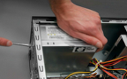 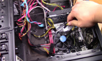 <br> Remova a fonte de alimentação que está conectada à placa-mãe por um conector de 20 pinos e um de 4 pinos. |
| 6. Remover HDD e unidade óptica | 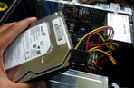 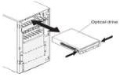 <br> Remova o cabo SATA conectado ao HDD e à unidade óptica na placa-mãe. |
| 7. Remover módulos de RAM | Para remover a RAM: <br> 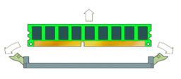|
| 8. Remover placas de expansão | 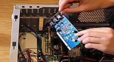 <br> Para remover as placas de expansão, desconecte os cabos conectados a elas. |
| 9. Remover a placa-mãe | 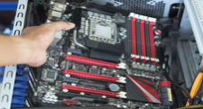 <br> Para remover a placa-mãe, desconecte todos os cabos da placa-mãe. Retire-a de frente para você e coloque em um saco antiestático. |